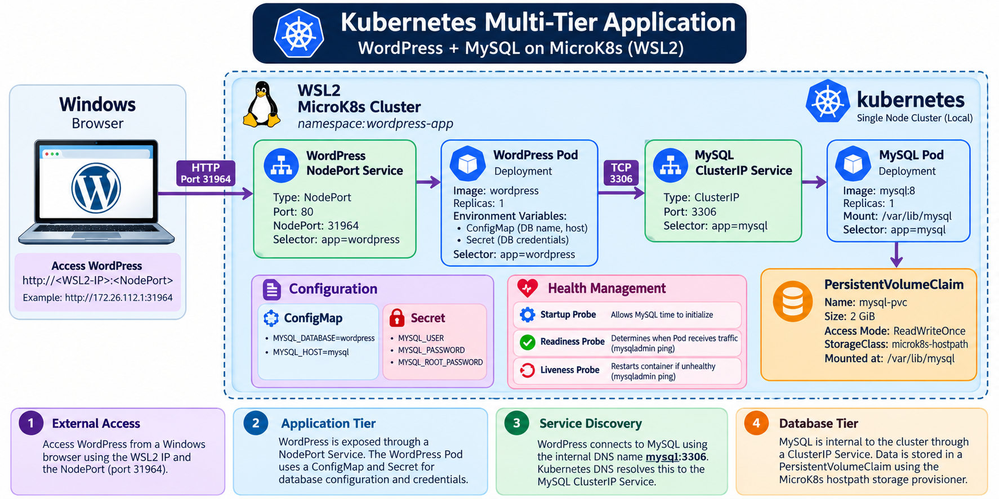
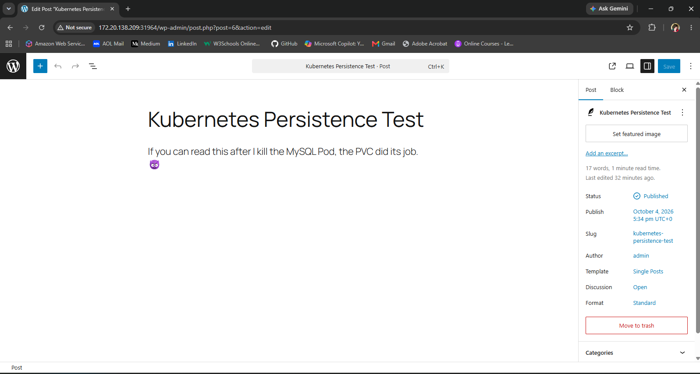
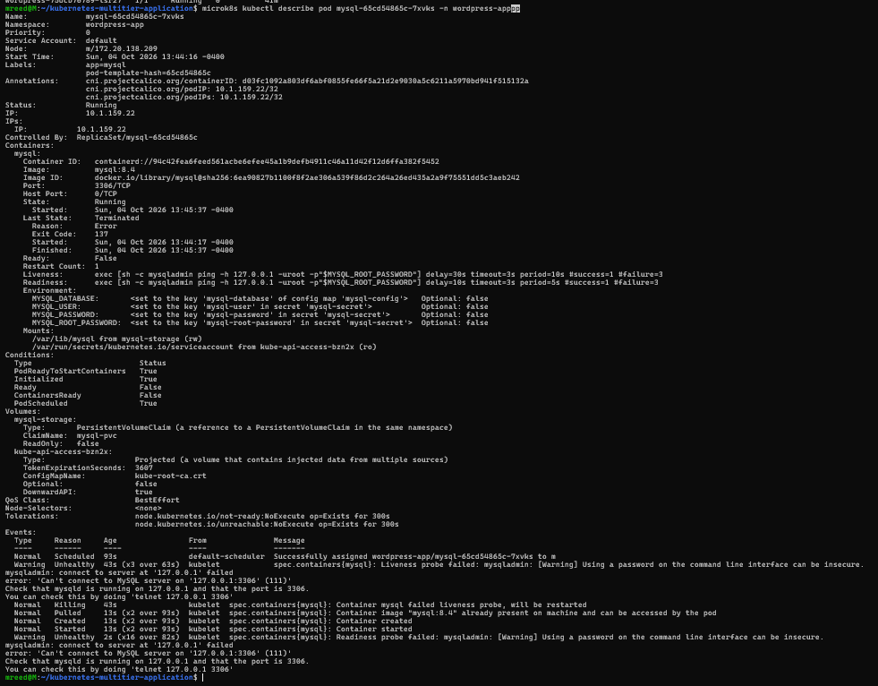
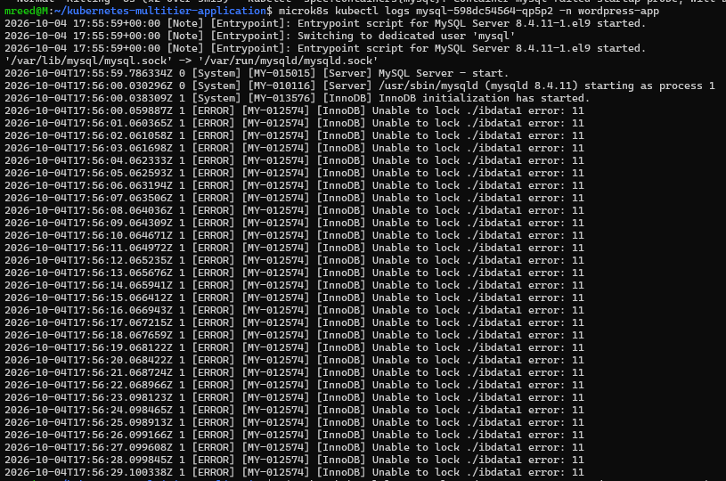
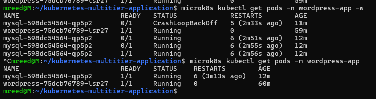
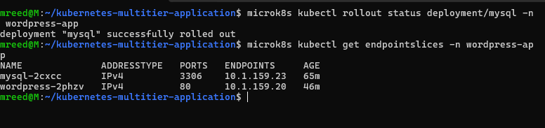
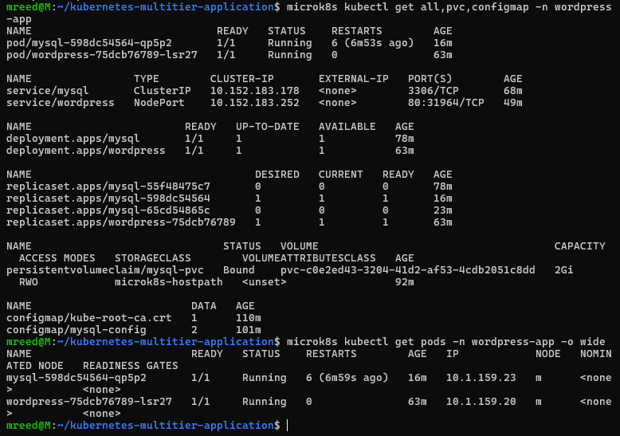
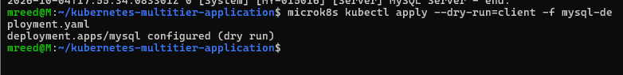
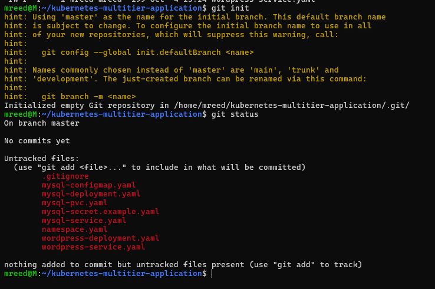

# Kubernetes Multi-Tier Application

A hands-on Kubernetes project deploying a multi-tier WordPress and MySQL application while exploring service discovery, persistent storage, configuration management, secrets, health probes, self-healing, and troubleshooting stateful workloads.

This project was built on a local single-node MicroK8s cluster running in WSL2.

## Architecture



The application follows a multi-tier architecture running on a local MicroK8s cluster in WSL2.

- A Windows browser accesses WordPress through the WSL2 IP and Kubernetes NodePort.
- The WordPress Service routes traffic to the WordPress Pod.
- WordPress connects to MySQL using the internal Kubernetes DNS name `mysql:3306`.
- The MySQL ClusterIP Service routes database traffic to the MySQL Pod.
- MySQL stores its data on a PersistentVolumeClaim backed by MicroK8s hostpath storage.
- ConfigMaps and Secrets provide application configuration and database credentials.
- Startup, readiness, and liveness probes monitor MySQL health.

## Kubernetes Concepts Practiced

- Namespaces
- Deployments and ReplicaSets
- Pods and desired state
- Services and selectors
- ClusterIP and NodePort
- Kubernetes DNS and service discovery
- ConfigMaps
- Secrets
- PersistentVolumes and PersistentVolumeClaims
- StorageClasses and dynamic provisioning
- EndpointSlices
- Startup, readiness, and liveness probes
- Self-healing
- Deployment strategies
- Troubleshooting with `kubectl get`, `describe`, and `logs`

## Project Structure

```text
.
├── namespace.yaml
├── mysql-configmap.yaml
├── mysql-secret.example.yaml
├── mysql-pvc.yaml
├── mysql-deployment.yaml
├── mysql-service.yaml
├── wordpress-deployment.yaml
├── wordpress-service.yaml
├── screenshots/
└── .gitignore
```

The actual `mysql-secret.yaml` used by the local environment is intentionally excluded from Git.

`mysql-secret.example.yaml` provides placeholder values that can be customized when recreating the project.

## Namespace

The application resources are isolated inside the `wordpress-app` namespace.

This provided a logical boundary for the WordPress and MySQL resources and made it easier to query and troubleshoot the application as a unit.

## Configuration and Secrets

Non-sensitive database configuration is stored in a ConfigMap, including the database name and MySQL Service hostname.

Sensitive values such as the MySQL username, password, and root password are supplied through a Kubernetes Secret.

The real Secret manifest is excluded through `.gitignore`.

```text
ConfigMap
   |
   +-- mysql-host = mysql
   +-- mysql-database = wordpress

Secret
   |
   +-- mysql-user
   +-- mysql-password
   +-- mysql-root-password
```

WordPress consumes these values as environment variables rather than hard-coding database configuration into the container definition.

## Persistent Storage

MySQL stores its database files in `/var/lib/mysql`.

A PersistentVolumeClaim was created so those files would exist independently of the lifecycle of any individual MySQL Pod.

During the initial deployment, the PVC remained `Pending` because no StorageClass was available.

After enabling the MicroK8s hostpath storage provisioner, the cluster provided the `microk8s-hostpath` StorageClass. Once the MySQL Pod consumed the claim, Kubernetes dynamically provisioned storage and the PVC became `Bound`.

## Service Discovery and Application Communication

MySQL is exposed internally using a `ClusterIP` Service:

```text
mysql:3306
```

WordPress uses `mysql` as its database hostname.

Kubernetes DNS resolved that name to the MySQL Service rather than directly to a Pod IP.

This was verified from inside the WordPress Pod:

```bash
microk8s kubectl exec deployment/wordpress -n wordpress-app -- getent hosts mysql
```

The result resolved the full Kubernetes DNS name:

```text
mysql.wordpress-app.svc.cluster.local
```

TCP connectivity to MySQL was then independently tested from the WordPress container on port `3306`.

This demonstrated the complete internal path:

```text
WordPress Pod
      |
      | mysql:3306
      v
MySQL Service
      |
      v
MySQL Pod
```

## External Access

WordPress is exposed using a `NodePort` Service while MySQL remains internal.

Because MicroK8s is running inside WSL2, accessing the application from Windows required using the WSL2 IP address rather than the Linux `localhost` address.

This created the full application path:

```text
Windows Browser
      |
      v
WSL2 / MicroK8s Node
      |
      v
WordPress NodePort
      |
      v
WordPress Pod
      |
      v
MySQL ClusterIP
      |
      v
MySQL Pod
      |
      v
Persistent Storage
```

## Self-Healing and Persistence Test

To test Kubernetes self-healing, the running MySQL Pod was deliberately deleted.

The MySQL Deployment specified one desired replica, so Kubernetes detected that actual state no longer matched desired state and automatically created a replacement Pod.

The replacement received a new Pod name and IP address.

WordPress required no configuration change because it communicates with the stable `mysql` Service instead of a Pod IP.

Before deleting the MySQL Pod, a WordPress post named **Kubernetes Persistence Test** was created.

After Kubernetes replaced the database Pod, the post remained available.



This demonstrated an important distinction:

**The Pod did not survive. The data did.**

The Deployment restored the compute resource while the PVC preserved the database state.

## Health Probes: Running Does Not Mean Ready

Startup, readiness, and liveness probes were added to MySQL using `mysqladmin ping`.

During the rollout, a replacement MySQL container reached the `Running` state while remaining `0/1` Ready.



This demonstrated that container state and application readiness are different concepts.

A running container only means the container process has started.

A Ready Pod means Kubernetes has determined that the workload is prepared to receive traffic.

The probes served three different purposes:

- **Startup probe** — allows MySQL sufficient time to initialize before normal health checks take over.
- **Readiness probe** — determines whether the Pod should receive Service traffic.
- **Liveness probe** — determines whether an unhealthy running container should be restarted.

## Troubleshooting: When the MySQL Rollout Failed

One of the most valuable parts of this project came from an unexpected failure.

After adding health probes, the MySQL Deployment attempted a rolling update.

The old MySQL Pod remained healthy while Kubernetes created a replacement Pod.

The replacement repeatedly failed to become Ready.

Rather than changing settings at random, troubleshooting followed the application stack:

```text
kubectl get
     |
     v
kubectl describe
     |
     v
kubectl logs
     |
     v
Application error identified
```

Initially, probe timing appeared to be the likely problem.

Application logs revealed the actual root cause:

```text
[InnoDB] Unable to lock ./ibdata1 error: 11
```



The old and new MySQL Pods were attempting to use the same persistent database directory during the rolling update.

Although the PVC used `ReadWriteOnce`, both Pods were running on the same single Kubernetes node. The volume could therefore be mounted while MySQL itself prevented two independent server processes from simultaneously locking the same InnoDB database files.

The issue was not ultimately a networking failure, lost storage, or simply an overly aggressive probe.

It was an application architecture and deployment-strategy problem.

## Correcting the Deployment Strategy

For this single-instance learning environment, the MySQL Deployment strategy was changed from the default rolling update behavior to:

```yaml
strategy:
  type: Recreate
```

This prevents the old and replacement MySQL Pods from intentionally overlapping during future Deployment updates.

The tradeoff is temporary database downtime during an update, which is acceptable for this local lab but would require a different architecture for a highly available production database.

After correcting the deployment behavior, MySQL successfully recovered and returned to the Ready state.



The Deployment then completed successfully and Kubernetes registered the new MySQL Pod as the Service endpoint.



Most importantly, the WordPress persistence-test data was still present after the database recovery.

## Final Validation

The completed environment contained:

- One healthy WordPress Pod
- One healthy MySQL Pod
- WordPress NodePort Service
- MySQL ClusterIP Service
- Bound 2 GiB MySQL PVC
- ConfigMap-based database configuration
- Secret-based credentials
- Working Kubernetes DNS
- Working WordPress-to-MySQL communication
- Startup, readiness, and liveness probes
- Persistent application data



All publishable Kubernetes manifests were also validated with a client-side dry run before being committed.



## Secret Management

The real MySQL Secret is intentionally excluded from source control.

The repository contains:

```text
mysql-secret.example.yaml
```

with placeholder values instead.

`.gitignore` prevents the real Secret from being staged:

```text
mysql-secret.yaml
```

Git was explicitly checked before committing to verify that the local Secret was excluded.



For a production environment, I would use a dedicated secret-management solution rather than storing production credentials directly in Kubernetes manifests.

## Docker Swarm vs Kubernetes

This project rebuilt a familiar WordPress and MySQL architecture previously explored with Docker Swarm.

Docker Swarm introduced multi-node services, overlay networking, scaling, shared storage, and service-level orchestration.

Kubernetes exposed more of the individual orchestration building blocks:

| Docker Swarm | Kubernetes |
|---|---|
| Service | Deployment + Service |
| Service name discovery | Kubernetes Service + CoreDNS |
| Replicas | Deployment / ReplicaSet |
| Shared/persistent storage | PV / PVC / StorageClass |
| Service configuration | ConfigMaps |
| Secrets | Secrets |
| Health management | Startup / readiness / liveness probes |
| Desired state | Controllers / Deployments |

Working with both made the abstraction differences much clearer.

Kubernetes requires more individual resources, but those resources provide fine-grained control over networking, configuration, storage, health, and workload lifecycle.

## Production Considerations

This project intentionally uses a local, single-node environment for learning.

For a production deployment, I would consider:

- Ingress or a cloud LoadBalancer instead of directly exposing a NodePort
- TLS and DNS for external traffic
- Managed or highly available persistent storage
- A managed database service such as Amazon RDS, or an appropriately designed Kubernetes database architecture
- StatefulSets when stable workload identity and stateful orchestration are required
- External secret management
- Resource requests and limits
- NetworkPolicies
- Backups and restore testing
- Monitoring and alerting
- CI/CD-based manifest deployment
- Multiple worker nodes for workload availability

## Key Takeaways

The biggest lesson from this project was that getting Pods into a `Running` state is only the beginning.

I learned how Kubernetes connects multiple application tiers through Services and DNS, separates configuration from secrets, preserves state independently of Pods, reconciles desired state after failures, and uses health probes to make traffic and restart decisions.

The unexpected MySQL rollout failure was particularly valuable.

Instead of assuming the first hypothesis was correct, I used Kubernetes events and MySQL logs to move from symptom to root cause:

```text
0/1 Ready
   ↓
Probe failures
   ↓
Container restarts
   ↓
MySQL logs
   ↓
ibdata1 lock
   ↓
Overlapping stateful Pods
   ↓
Deployment strategy
   ↓
Recreate
   ↓
Healthy rollout
```

That troubleshooting process was ultimately more valuable than a deployment that worked perfectly on the first attempt.
